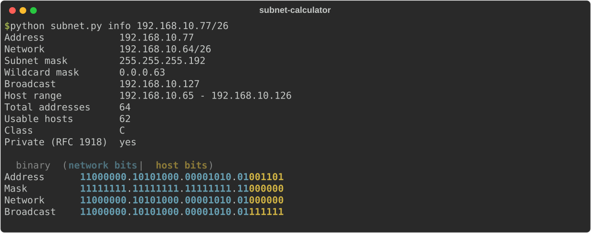
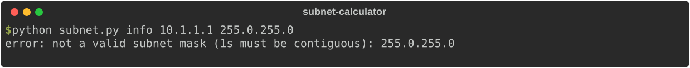
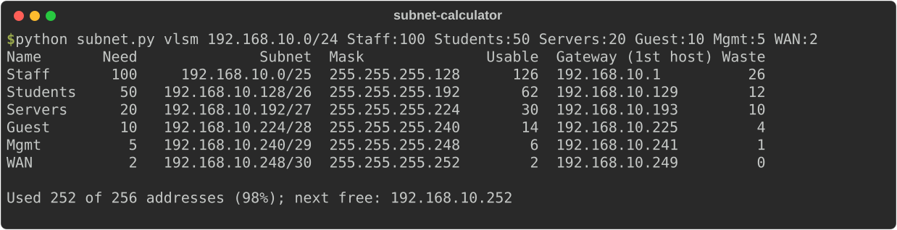
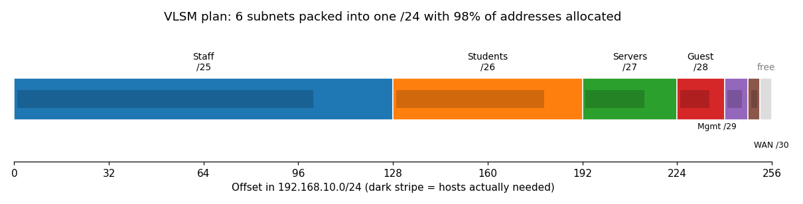
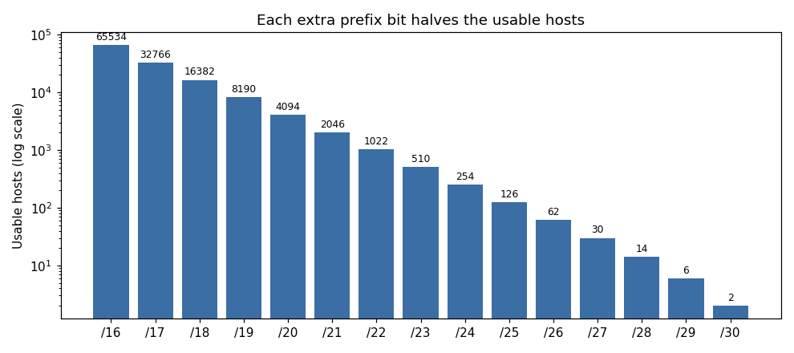

# IPv4 Subnet Calculator & VLSM Planner

**Quick summary:** A zero-dependency Python CLI that breaks down any IPv4 address/mask, splits networks into equal subnets, and builds VLSM addressing plans. The math is implemented by hand with bitwise operations and verified against Python's `ipaddress` module on 2,000 random cases.



## Description
Three commands:

| Command | What it does |
|---|---|
| `info 192.168.10.77/26` | Network, broadcast, mask, wildcard, host range, usable hosts, class, private/public, with a color-coded **binary view** that shows which bits belong to the network and which to the host |
| `split 10.0.0.0/24 4` | Divide a network into N equal subnets |
| `vlsm 192.168.10.0/24 Staff:100 Students:50 ...` | Plan subnets of different sizes with as little waste as possible |

Accepts CIDR (`/26`) or dotted masks (`255.255.255.192`), and rejects invalid input such as non-contiguous masks:



### VLSM planning



This exact plan is the addressing scheme for my **[Packet Tracer campus network](https://github.com/victorfang-edit/packet-tracer-campus-network)** project.

## Tools Used
- **Python** (standard library only)
- Bitwise operators (`&`, `|`, `~`, `<<`) for all subnet math
- `ipaddress` (stdlib), used **only in tests** as the reference answer
- Matplotlib for the charts

## Scope
IPv4 only: info, equal split, VLSM. IPv6 and route summarization are future work.

## Objective
Subnetting is a core skill for CompTIA Network+, CCNA, and any help desk or network admin job. Building the calculator forced me to understand the binary math instead of memorizing charts.

## Result
- All 7 test groups pass, including 2,000 randomized cross-checks against the standard library.
- Handles the edge cases: `/31` point-to-point links (RFC 3021, 2 usable), `/32` host routes, invalid octets, and non-contiguous masks.
- The VLSM example fits 6 subnets into one /24 and allocates 98% of the space.



## What I Learned
- **Network = IP AND mask** · **Broadcast = network OR (NOT mask)** · **Wildcard = NOT mask** (used in ACLs and OSPF).
- Usable hosts = 2^(host bits) − 2, because the network and broadcast addresses are reserved.
- **VLSM:** allocate the *largest* subnet first so every block lands on a boundary that matches its size, which avoids overlaps.
- Why a mask like `255.0.255.0` is invalid: the 1-bits must be contiguous.
- Testing against a trusted reference (the stdlib) is the fastest way to trust your own implementation.

## Run It
```bash
python subnet.py info 192.168.10.77/26
python subnet.py info 172.16.5.4 255.255.240.0
python subnet.py split 10.0.0.0/24 4
python subnet.py vlsm 192.168.10.0/24 Staff:100 Students:50 Servers:20 Guest:10 Mgmt:5 WAN:2
python test_subnet.py
```
